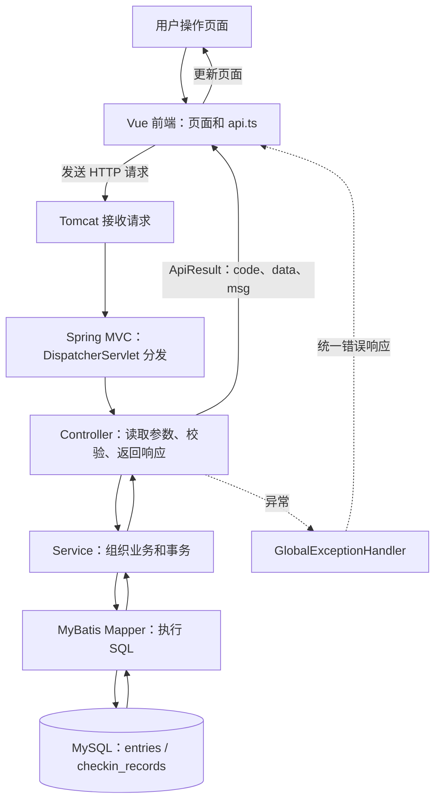
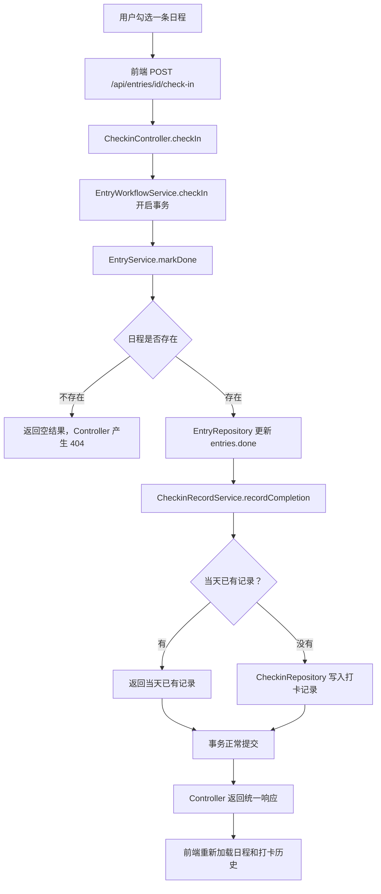

# 每日日程：功能与数据流转

本文记录当前项目的功能、数据保存位置和请求经过的代码，适合配合 IDEA 阅读。前端位于独立的 `daily-checkin-web` 项目；本后端的 `src/main/resources/static` 仍保留旧版页面。两套页面都调用本后端接口。

## 一、目前有哪些功能

| 功能 | 当前行为 | 主要数据位置 |
| --- | --- | --- |
| 今日计划 | 展示日期为今天的日程，并统计完成数量和进度 | `entries` 表 |
| 日程管理 | 查询、新建、编辑、删除日程；独立前端支持按状态筛选 | `entries` 表 |
| 完成打卡 | 将日程标记为完成，同时记录一次打卡 | `entries` 和 `checkin_records` 表 |
| 取消完成 | 将日程恢复为未完成，保留过去的打卡记录 | 修改 `entries.done` |
| 打卡历史 | 查看曾经完成的记录，可通过接口按打卡日期查询 | `checkin_records` 表 |
| 浏览器提醒 | 页面开启且获得通知权限时，接近指定时间弹出通知 | 日程的日期和提醒时间；开关在浏览器本地 |
| 我的 | 独立前端的个人页面，目前显示本地模式和未来功能说明 | 当前没有账号数据 |

提醒由前端页面检查时间，不是服务器后台推送；关闭页面、设备休眠或错过时间后不会补发。当前没有登录、退出和个人信息保存功能。

## 二、整体流程图



可以把 Controller 想成接待员，负责收请求和回复；Service 像负责人，决定业务步骤；Mapper 负责执行数据库操作；MySQL 保存数据。异常处理器负责把控制器处理过程中出现的相应异常整理成响应。

## 三、数据表之间的关系

### `entries`：日程当前状态

| 字段 | 含义 |
| --- | --- |
| `id` | 数据库生成的日程编号 |
| `title`、`note` | 标题和备注 |
| `entry_date`、`reminder_time` | 日程日期和可选提醒时间 |
| `done` | 当前是否完成 |

### `checkin_records`：已经发生的打卡

| 字段 | 含义 |
| --- | --- |
| `id` | 打卡记录编号 |
| `entry_id` | 对应日程的编号；删除原日程后会置为 `null` |
| `entry_title` | 打卡时的标题快照，日程改名后仍保留原记录 |
| `checkin_date`、`checked_at` | 使用上海时区确定的实际打卡日期和时间 |

当前状态和历史记录的用途不同：取消完成会把 `done` 改回 `false`，但历史记录仍然保留。删除日程时，数据库外键设置为 `ON DELETE SET NULL`，因此打卡标题和时间也会保留。同一日程同一天最多保存一条记录；历史打卡不会根据原有已完成日程自动补建。

## 四、打卡时数据怎样流转



`EntryWorkflowService` 是协调者，它调用两个 Service。它的方法加了 `@Transactional`：正常结束时提交；符合回滚规则的异常向外抛出时，日程状态更新和记录写入会一起回滚。同一日程同一天的唯一键能防止重复数据，并发请求仍可能出现唯一键冲突错误。

阅读顺序：`CheckinController.checkIn()` → `EntryWorkflowService.checkIn()` → `EntryService.markDone()` → `EntryRepository.updateDone()` → `CheckinRecordService.recordCompletion()` → `CheckinRepository`。前一步拿到结果后，再执行后一步。

## 五、新建、编辑与删除

1. **新建**：前端发送标题、日期、备注等 JSON → `EntryController.create()` 用 `@Valid` 校验 → `EntryService.createEntry()` 清除传入 ID 并设为未完成 → Mapper 插入 → MyBatis 回填数据库生成的 ID → 查询并返回新日程。
2. **编辑**：前端发送完整日程 → `EntryController.update()` → `EntryWorkflowService.updateEntry()` → 锁定并读取原状态后更新 → 只有从未完成变为已完成时才记录当天打卡 → 返回日程。不存在时返回 404；编辑已完成日程不会补记打卡。
3. **取消完成**：前端调用 `reopen` → `EntryWorkflowService` 调用 `EntryService.markUndone()` → 更新当前状态，历史不删除。
4. **删除**：`EntryController.delete()` → `EntryService.deleteEntry()` → `EntryRepository.deleteById()`。返回的受影响行数用于判断是否找到日程；数据库保留历史快照。

## 六、接口一览

| 方法和地址 | 用途 | 成功状态 |
| --- | --- | --- |
| `GET /api/entries` | 查询全部日程 | 200 |
| `POST /api/entries` | 新建日程 | 201 |
| `PUT /api/entries/{id}` | 更新日程 | 200 |
| `DELETE /api/entries/{id}` | 删除日程 | 200 |
| `POST /api/entries/{id}/check-in` | 完成日程并打卡 | 200 |
| `POST /api/entries/{id}/reopen` | 恢复未完成 | 200 |
| `GET /api/checkins` | 查询打卡历史；可加 `?date=YYYY-MM-DD` | 200 |

独立前端的列表通过分页接口在数据库中先筛选再分页；今日统计和浏览器提醒目前仍读取全部日程。打卡日期筛选接口已经存在，但页面尚未提供日期筛选控件。

### 分页接口

| 方法和地址 | 可选参数 | 用途 |
| --- | --- | --- |
| `GET /api/entries/page` | `page`、`size`、`date`、`done` | 按日程日期和完成状态筛选并分页 |
| `GET /api/checkins/page` | `page`、`size`、`date` | 按实际打卡日期筛选并分页 |

`page` 默认 1，`size` 默认 10、范围 1～100；非法参数返回 400。统一响应的 `data` 包含 `items`（当前页数组）、`total`（筛选后的总条数）、`page` 和 `size`。页码超出范围时 `items` 为空。数据库使用 `LIMIT` 和 `OFFSET` 取一页，并另用 `COUNT(*)` 计算总数。两个查询是独立执行的，并发修改数据时总数与列表可能出现短暂差异。

## 七、统一响应如何返回

成功时 Controller 使用 `ApiResult.success(data)` 包装数据，例如：

```json
{
  "code": 0,
  "data": [],
  "msg": "成功"
}
```

`data` 可以是对象、数组或 `null`；`code=0` 是本项目约定的业务成功码。业务码放在 JSON 中，HTTP 状态码放在 HTTP 响应中，是两个不同的值。

日程不存在时，Controller 抛出 `ResponseStatusException`，`GlobalExceptionHandler` 将其转为 HTTP 404 和统一错误响应。参数校验失败通常返回 HTTP 400；未预料的异常记录在服务端日志中，客户端收到通用错误消息。前端 `api.ts` 同时检查 HTTP 状态和 `code`，成功后取出 `data`。

## 八、主要源码位置

| 路径 | 作用 |
| --- | --- |
| `src/main/java/com/example/daily/controller/` | 接收日程与打卡请求 |
| `src/main/java/com/example/daily/service/` | 业务步骤、Service 协作和事务 |
| `src/main/java/com/example/daily/mapper/` | MyBatis 查询、插入、更新和删除 |
| `src/main/java/com/example/daily/domain/` | Java 日程与打卡数据对象 |
| `src/main/java/com/example/daily/common/` | 统一响应和全局异常处理 |
| `sql/init.sql` | 创建数据库和数据表 |
| `daily-checkin-web/src/api.ts` | 独立前端的接口请求与响应解析 |

上述前端路径相对于 `daily-checkin-web` 项目，其他路径相对于后端项目。
