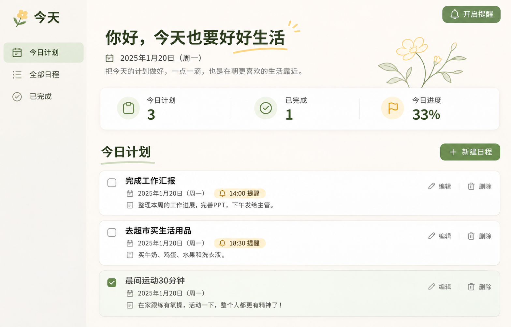

# 「今天」每日日程打卡项目计划书

## 一、项目目标

开发一个单人使用的本地日程应用，帮助用户记录每天的计划和备注、完成打卡，并在页面打开时收到浏览器提醒。通过这个项目练习从网页到 Java 后端再到数据库的完整流程。

## 二、UI 设计

示意图使用浅米色背景、白色卡片和柔和绿色，营造轻松、专注的氛围。它是视觉设计参考，示例内容和装饰不代表程序的实际截图；以运行中的页面为准。

| 区域 | 功能 | 对应代码 |
| --- | --- | --- |
| 左侧导航 | 切换今日计划、全部日程、已完成 | `index.html`、`app.js` |
| 顶部提醒按钮 | 请求浏览器通知权限 | `app.js` |
| 统计卡片 | 显示今日总数、已完成数和完成百分比 | `app.js` 的 `render` |
| 日程列表 | 显示标题、日期、提醒时间和备注；打卡、编辑、删除 | `app.js` 的 `render` |
| 新建日程弹窗 | 输入标题、日期、提醒时间和备注 | `index.html`、`app.js` |

## 三、功能范围与验收

| 功能 | 验收方式 |
| --- | --- |
| 新建与记事 | 输入标题和日期，可选填写备注和提醒时间，保存后出现在列表 |
| 查看 | 能切换今日、全部、已完成列表 |
| 编辑与删除 | 保存修改后重新打开页面仍有效；删除后不再出现 |
| 打卡 | 点击复选框可完成或取消完成，今日统计随之变化 |
| 提醒 | 允许通知并保持页面打开，在指定日期和时间收到浏览器通知 |
| 数据保存 | 重启服务后已保存的日程仍存在 |

提醒目前不是每天自动重复的闹钟；页面关闭、设备休眠或错过指定分钟后不会补发。项目没有账号和权限系统，仅用于本地学习。

## 四、技术与数据流

- 前端：HTML 构建页面，CSS 控制布局，JavaScript 处理交互并通过 `fetch` 请求接口。
- 后端：Java 和 Spring Boot 提供 REST 接口；MyBatis Mapper 负责数据库操作。
- 数据库：本机 MySQL `daily_checkin`；迁移后保留的旧 H2 文件位于本机忽略目录 `本地开发/data/`，不参与当前运行，也不推送到仓库。

以新建日程为例：填写表单 → JavaScript 发送 `POST /api/entries` → `EntryController` 绑定请求并校验 → `EntryService` 组织新建流程 → `EntryRepository` 使用 MyBatis 保存到 MySQL → 返回结果 → 页面重新加载列表。

日程数据包括：编号、标题、备注、日期、提醒时间和完成状态。接口还包括 `GET /api/entries` 查询、`PUT /api/entries/{id}` 修改和 `DELETE /api/entries/{id}` 删除。

## 五、学习与实践计划

你已有前端开发基础和 Git 经验，因此本项目跳过前端入门和 Git 教学，使用现有页面直接做接口联调。学习进度不按固定周数赶，而按概念理解和项目里程碑推进；Java 基础已覆盖的内容用于巩固，不重新从最简单语法逐条开始。

唯一的后端课程顺序、当前进度和下一步维护在 [后端学习计划表](后端学习计划表.md)。主线为：Java 应用巩固 → Maven 与项目结构（按需穿插）→ Spring IoC/Bean/依赖注入 → Spring Boot → HTTP/Tomcat/Servlet 必要概念与 Spring MVC → Controller/Service/Mapper 分层 → SQL 与 MyBatis → 测试和打包。

当前项目使用 MyBatis，不把 JPA 作为前置课程；不要求另写传统 JSP 项目或完整原生 JDBC CRUD。Servlet/Tomcat 和 JDBC 只讲清楚理解当前项目所需的部分。已学 MySQL 以复习 SQL 和应用读写为主。项目的 CRUD 链路为 `Controller → Service → Mapper`；Service 组织业务步骤，Controller 处理 HTTP，Mapper 执行 SQL。

个人学习笔记保存在本机 `本地开发/学习笔记/`，包括每日记录和主题分类，并由 Git 忽略、不推送到远端。笔记中不记录真实数据库密码等凭据。

功能扩展完成标准：可以选择并保存优先级，列表能显示，修改后刷新页面数据仍保留。遇到数据库结构变更时，先备份实际 MySQL 数据目录，并按项目 README 中的本机操作步骤处理。

## 六、项目现状与启动

项目源码已创建。使用 JDK 17、Maven 和本机 MySQL，参照 [README](README.md) 配置并启动项目，再按第三部分逐项验收。首次启动需要下载依赖。

UI 图使用内置图像生成工具生成，提示词概述：以现有功能为范围，绘制浅米色与柔和绿色的中文桌面日程应用，包括侧栏、统计、提醒按钮和任务卡片。
